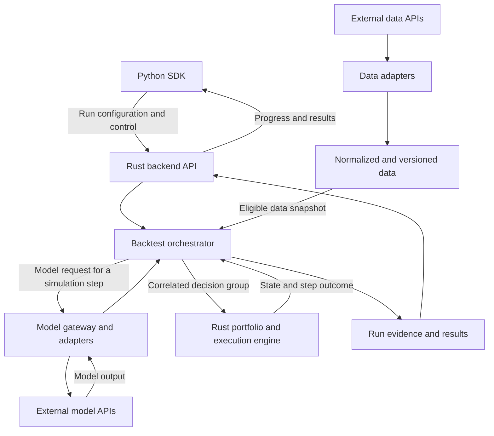

# Architecture overview

**Status:** Accepted language/API direction and responsibility boundaries. The controlled local implementation uses the components below; real-provider integrations and deployment beyond loopback remain Open.

## Accepted foundation

The public client is a pure Python SDK. The backend and backtest engine are written in Rust. Initial communication uses HTTP/JSON. External data and model services can use other languages behind their adapters. See [ADR 0001](../decisions/0001-python-sdk-rust-backend.md).

These boundaries describe responsibilities. They do not require separate deployments for each internal component or an embedded native extension in the SDK.

## Intended data and control flow

The orchestrator advances a scenario by coordinating eligible data, model responses, and engine transitions. State snapshots used for inference come from that scenario's engine state.

## Component responsibilities

| Component | Owns | Boundary |
| --- | --- | --- |
| Python SDK | Client configuration, run submission, tracking, and result access | Does not own simulation accounting or external inference execution |
| Backend API | Client-facing validation and access to run operations | Does not define financial execution rules |
| Orchestrator | Run/step coordination, adapter invocation, response correlation, and progress | Delegates portfolio transitions to the engine |
| Data adapters and layer | Provider integration, normalization, source/version metadata, and snapshot assembly | Do not infer unavailable historical publication times |
| Model gateway and adapters | Model-service integration and output validation/correlation | Do not invent replacement decisions on failure |
| Portfolio and execution engine | Simulation clock semantics, capital constraints, order/fill processing, and state transitions | Does not implement HTTP transport retry policy |
| Evidence and results | Local sealed configuration, inputs, responses, transitions, result references, and verified artifact reads | Durable storage service and retention remain Open |

## Shared-capital and scenario boundaries

Within a scenario, assets share the declared capital pool and portfolio constraints. A group of decisions is evaluated using a consistent pre-application snapshot. An explicit policy must resolve incompatible proposals or insufficient capital.

Across scenarios, mutable portfolio, pending-order, model, and random state must remain isolated where present. Immutable input data may be shared by explicit version or snapshot identity. If decisions depend on a scenario's holdings or prior actions, that scenario needs its own model invocation or isolated model state; outputs cannot be reused merely because the market timestamp matches.

## Time and failure boundaries

Simulated time controls data visibility and execution eligibility. Wall-clock time controls service operations. A slow inference call does not define a simulated trading delay unless a declared policy maps it to one.

The backend handles transport failures; the engine applies declared financial behavior. The local service has process-scoped idempotency, no automatic inference retry or fallback, and sealed filesystem evidence. Metadata and the bounded worker queue are in memory. This is not an exactly-once or restart-recovery guarantee.

Detailed semantics belong in the [simulation lifecycle](simulation-lifecycle.md). Conceptual exchanges belong in [service contracts](../interfaces/service-contracts.md).

The accepted [MVP 1 synthetic scope](../product/mvp-scope.md) defines the configured instruments, local model fixture, and execution/accounting rules. See the [instrument model](instrument-model.md), [decision policies](decision-policies.md), [synthetic accounting](synthetic-accounting.md), [margin risk](margin-risk.md), and [option valuation](options-valuation.md). Local implementation evidence is linked from the [documentation index](../README.md). Axum/Tokio serve HTTP; Python uses standard-library urllib; Rust contracts/data/engine/backend crates keep simulation separate from transport. These modules are not separate deployments.

## Open infrastructure decisions

- Deployment beyond the locally verified Windows/MSVC environment, including self-hosted versus managed service.
- Durable database/queue and remote storage formats beyond the selected local JSON evidence and in-process queue.
- Authentication, authorization, snapshot access, secret management, and tenancy.
- Distributed worker scheduling, scale targets, caching, retention, and operational telemetry beyond current local queue limits.
- Real-provider protocols and integrations beyond the selected synthetic data and stateless HTTP model exchange schemas.

Select these for an agreed implementation slice; do not infer them from the diagram.
