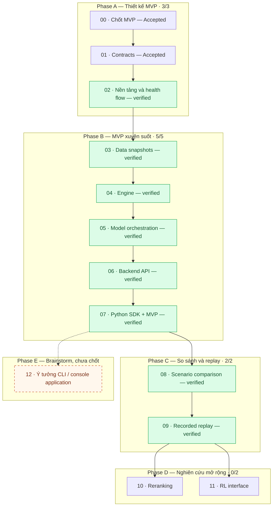

# Kế hoạch triển khai FactorsBT

**Status:** Kế hoạch theo dõi công việc; trạng thái từng stage phản ánh bằng chứng đã có.

**Mốc đối chiếu:** 2026-11-04. Phase A, B và C đã qua cổng kiểm chứng local: Stage 00–09, gồm fixture/snapshot, engine, model orchestration, Rust run/replay API, typed Python SDK, backtest, comparison tuần tự và recorded replay. Chưa có hosted deployment, public API stability hay CI.

## Cách đọc và phạm vi

Bộ kế hoạch gồm 12 stage triển khai (00–11) và mục brainstorm 12. Mỗi stage ghi mục tiêu, đầu ra, phụ thuộc, quyết định Open, Task → Commit, kiểm chứng dự kiến và điều kiện hoàn thành. Chỉ thực hiện code sau khi quyết định cần thiết của stage được chốt.

Hướng Accepted là SDK thuần Python, backend/engine Rust, giao tiếp ban đầu HTTP/JSON. Các quyết định synthetic MVP ở Stage 00 và contracts ở Stage 01 đã được ghi nhận; phần nào chưa có code và kiểm chứng vẫn chưa phải tính năng Implemented.

- Wave 1: Phase A–B, từ thiết kế MVP tới một backtest chạy xuyên suốt.
- Wave 2: Phase C, thí nghiệm so sánh và recorded-response replay.
- Wave 3: Phase D, hai hướng nghiên cứu độc lập reranking và RL, vẫn là Proposed.
- Phase E: chỗ ghi nhớ ý tưởng ứng dụng, chưa đưa vào wave thực thi hay lịch triển khai.

Số stage 00–12 là đánh số chi tiết trong thư mục này, không thay thế số Stage 0–3 trong [roadmap gốc](../../docs/roadmap.md). Phase A–B phân rã roadmap Stage 1, Phase C tương ứng Stage 2, Phase D tương ứng Stage 3; Phase E là ý tưởng bổ sung chưa chốt. Tài liệu nền tảng của roadmap Stage 0 không được tính là engine hay MVP đã chạy được.

## Danh mục và bảng theo dõi

| Phase | Stage / mục | Trạng thái thiết kế | Đạt điều kiện hoàn thành | Bằng chứng |
| --- | --- | --- | --- | --- |
| A | [00 — Quyết định MVP](00-mvp-decisions.md) | Accepted | Có | [Scope](../../docs/product/mvp-scope.md), [fixture và acceptance cases](../../docs/examples/mvp/acceptance-cases.md) |
| A | [01 — Contracts](01-contracts.md) | Accepted | Có | [OpenAPI](../../contracts/openapi.json), [run schema](../../contracts/schemas/run-configuration.schema.json), [shared example](../../contracts/examples/instruments/minimal-valid-spot-run.json), [contract docs](../../docs/interfaces/service-contracts.md) |
| A | [02 — Nền tảng dự án](02-project-foundation.md) | Implemented | Có | [Lệnh và bằng chứng local](../../docs/development/phase-a-local.md), [toolchain và kết quả kiểm chứng](../../docs/decisions/0002-phase-a-tooling.md#follow-up-verification-2026-11-03) |
| B | [03 — Data snapshots](03-data-snapshots.md) | Implemented | Có | [Fixture registry](../../rust/crates/data/src/lib.rs), [snapshot selector](../../rust/crates/data/src/snapshot.rs), [coverage checks](../../rust/crates/data/src/coverage.rs), [fixtures](../../contracts/fixtures/README.md) |
| B | [04 — Simulation engine](04-simulation-engine.md) | Implemented — controlled MVP path and focused financial-rule tests | Có | [Rust engine](../../rust/crates/engine/src/lib.rs), [controlled acceptance](../../rust/crates/engine/tests/controlled_acceptance.rs), [tests](../../rust/crates/engine/src) |
| B | [05 — Model orchestration](05-model-orchestration.md) | Implemented | Có | [Orchestrator](../../rust/crates/backend/src/orchestrator.rs), [model client](../../rust/crates/backend/src/model_client.rs), [concurrent isolation](../../rust/crates/backend/src/orchestrator.rs) |
| B | [06 — Backend API](06-backend-api.md) | Implemented | Có | [API routes](../../rust/crates/backend/src/api.rs), [runtime/workers](../../rust/crates/backend/src/runtime.rs), [loopback API tests](../../rust/crates/backend/src/api.rs) |
| B | [07 — Python SDK và nghiệm thu MVP](07-python-sdk-mvp.md) | Implemented | Có | [Typed SDK](../../python-sdk/src/factorsbt), [end-to-end smoke](../../python-sdk/tests/smoke_backtest.py), [failure-path smoke](../../python-sdk/tests/smoke_sdk_failures.py), [lệnh và kết quả local](../../docs/development/phase-b-local.md) |
| C | [08 — Scenario comparison](08-scenario-comparison.md) | Implemented — SDK tuần tự và report local | Có | [Comparison smoke](../../python-sdk/tests/smoke_backtest.py), [Phase C verification](../../docs/development/phase-c-local.md) |
| C | [09 — Recorded replay](09-recorded-replay.md) | Implemented — replay cùng executable/contract | Có | [Replay runtime](../../rust/crates/backend/src/runtime.rs), [replay source validation](../../rust/crates/backend/src/replay_source.rs), [Phase C verification](../../docs/development/phase-c-local.md) |
| D | [10 — Reranking](10-reranking.md) | Proposed | Chưa | Chưa có |
| D | [11 — RL interface](11-rl-interface.md) | Proposed | Chưa | Chưa có |
| E | [12 — Ý tưởng CLI / console application](12-cli-console-ideas.md) | Proposed — brainstorm | Không áp dụng | Chưa chốt triển khai |

Hiện có **10/12 stage triển khai đạt điều kiện hoàn thành**; MVP Phase B gồm stage 00–07 có **8/8**; Phase A là **3/3**, Phase B là **5/5**, Phase C là **2/2**. Phase C verification ghi 48 Python tests, 146 Rust tests, comparison smoke ba scenario (baseline, price-only, delayed-event), và replay cho ba output mode cùng source model-failure; replay source thành công được đọc lại sau khi restart backend. Các con số là stage qua cổng kiểm chứng, không phải tỷ lệ thời gian, khối lượng code hoặc ước lượng ngày giao hàng. Mục brainstorm 12 không nằm trong mẫu số.

Trạng thái thiết kế dùng đúng từ vựng của [documentation index](../../docs/README.md#status-vocabulary): Accepted, Proposed, Open và Implemented. Cột hoàn thành là theo dõi công việc riêng. Stage thiết kế có thể hoàn thành bằng quyết định được Accepted và tài liệu đã kiểm tra; điều đó không làm tính năng thành Implemented. Chỉ mô tả hành vi là Implemented khi có code và kiểm chứng phù hợp.

Khi tiến độ thay đổi, cập nhật hàng stage, số đếm, graph và dẫn chứng cùng nhau. Dẫn chứng cần chỉ đến quyết định, commit triển khai, kết quả kiểm tra và giới hạn liên quan. Viết xong file kế hoạch không phải bằng chứng hoàn thành stage.

## Graph tiến độ theo phase

Mũi tên liền biểu thị trình tự triển khai chính được đề xuất; phụ thuộc chi tiết nằm trong từng file stage. Hai nhánh Phase D độc lập nhau. Nét đứt tới Phase E chỉ gợi liên hệ ý tưởng, không phải phụ thuộc hay thời hạn đã chốt.

Phase E không yêu cầu Phase D hoàn thành. Mục 12 chưa chọn tính năng, ngôn ngữ, giao diện, dependency triển khai hoặc thời điểm làm; nếu được theo đuổi sẽ cần một kế hoạch riêng.

## Cổng hoàn thành theo phase

| Phase | Đầu vào / phụ thuộc | Kiểm chứng và điều kiện ra |
| --- | --- | --- |
| A | Docs nền tảng và ADR 0001 | Quyết định MVP đủ dùng được chốt; hai phía hiểu cùng hợp đồng; công cụ tối thiểu chạy được và lệnh được xác minh. |
| B | Phase A | Chạy từ SDK qua Rust backend, adapters và engine; evidence nối input tới portfolio; các ca temporal visibility, shared capital, execution và failure đúng quy tắc. |
| C | MVP Phase B | Scenario cách ly mutable state, khác biệt có thể giải thích; recorded replay được kiểm tra trong phạm vi công bố và khác fresh inference. |
| D | Comparison/replay Phase C và thiết kế nghiên cứu được chấp nhận | Mỗi nhánh có contract, ví dụ bounded và kiểm chứng với vốn, thời gian, isolation và replay; không cam kết model cải thiện. |
| E | Chưa xác lập đầu vào thực thi | Chỉ brainstorm; không có cổng nghiệm thu ứng dụng hoặc yêu cầu hoàn thành để đóng MVP. |

## Task, commit và kiểm chứng

### Lần tạo bộ tài liệu này — 2026-11-02

- Làm trực tiếp trên `main`; tạo stage 00–11, mục 12 rồi README, mỗi file một commit: 14 commit.
- Commit stage có dạng `docs(plan): add stage 00 MVP decisions`; mục 12 là `docs(plan): record CLI console application ideas`; README là `docs(plan): add implementation overview and phase graph`.
- Chỉ stage đường dẫn tường minh. Trước mỗi commit kiểm tra branch, working tree, index, staged diff và whitespace; sau commit kiểm tra file và summary.
- Kiểm tra links, Markdown, thuật ngữ, status, dependencies, graph và diff của cả bộ; sau đó push lên `origin/main` theo phạm vi đã duyệt. Không thêm CI, dependency hoặc code sản phẩm.
- Tại thời điểm tạo kế hoạch chưa có source implementation hay test code. Repository chưa có CI tại mốc đối chiếu; không báo CI passed khi không có run.

### Tiến độ thực hiện Phase A — 2026-11-03

- Các commit 17–27 trên `main` tạo tooling ADR, Rust workspace/contracts/backend, Python package/client, shared-example tests, smoke script và hướng dẫn local. Commit 29 sửa cảnh báo Clippy; commit 30 đóng Phase A sau khi qua cổng. Danh sách chi tiết nằm trong [Stage 02](02-project-foundation.md).
- `cargo fmt`, `cargo clippy`, `cargo check`, `cargo test`, Cargo metadata, 8 Python tests và JSON Schema Draft 2020-12 validation đều pass. Rust có 11 unit tests và 3 shared-example tests.
- Smoke test chạy backend trong Developer Command Prompt và xác minh `Client.health()` gọi được `GET /healthz`; script cleanup tiến trình thành công. CI chưa được cấu hình.
- 28 commit ban đầu đã nằm trên `main`; các commit sửa và closeout nối tiếp. Push sau khi kiểm tra remote `origin/main` còn fast-forward được.
- Các lần tiếp theo tiếp tục theo [commit-workflow](../../.agents/skills/commit-workflow/SKILL.md), xác minh diff/staged scope, test và trạng thái remote cho từng đợt.
- Chốt quyết định Open trước khi task phụ thuộc bắt đầu; cập nhật contracts hai phía và ảnh hưởng tới kết quả lưu trữ. Ghi ADR cho thay đổi kiến trúc đáng kể, không xóa lịch sử quyết định cũ.
- Giữ các ranh giới: event/availability/processing time; decision/order/fill; mutable scenario state/immutable input; recorded replay/fresh inference.

### Tiến độ thực hiện Phase B — 2026-11-03

- Stage 03–04 đã có fixture registry/snapshot và engine primitives với controlled acceptance evidence. Stage 05 hoàn tất model HTTP adapter, correlated orchestration, failure evidence và concurrency isolation qua các commit 31–38; Stage 06 hoàn tất queue, worker runtime, bốn run operations và API integration qua commits 39–47. Các commit được liệt kê trong [Stage 05](05-model-orchestration.md) và [Stage 06](06-backend-api.md).
- Kiểm tra cuối Phase B: `cargo fmt --all -- --check`, `cargo check --workspace --all-targets --offline`, `cargo clippy --workspace --all-targets --offline -- -D warnings` và `cargo test --workspace --offline` pass. Workspace test suite có 140 tests; Python SDK unittest có 40 tests.
- Loopback API tests xác minh hai run đang inference đồng thời và response hoàn tất đảo thứ tự, cùng-key POST không tạo run trùng, queue overflow, model failure, result retrieval và integrity failure sau khi sửa artifact.
- Typed SDK smoke chạy qua Rust backend cho `scores`, `targets` và `order_intents`; kiểm tra độc lập NAV theo Decimal và SHA-256/size của evidence. Failure-path smoke xác minh mất acknowledgment rồi tra cứu, submission conflict, model HTTP failure và wait timeout không hủy backend run.
- API chỉ hỗ trợ loopback, in-memory metadata/deduplication và local evidence. Không có CI, hosted deployment, remote artifact download, cancellation, streaming, restart recovery hay tuyên bố public API stability. Chi tiết toolchain, lệnh và giới hạn nằm trong [hướng dẫn xác minh Phase B](../../docs/development/phase-b-local.md).
- **Đóng Phase B:** Phase A 3/3, Phase B 5/5, tổng 8/12 stage triển khai, MVP 8/8. Stage 08–11 và brainstorm mục 12 giữ nguyên Proposed.

### Tiến độ thực hiện Phase C — 2026-11-04

- Stage 08 hoàn tất comparison SDK tuần tự, metrics, cấu hình khác biệt, timeline/trace evidence, lưu report và giữ trạng thái partial khi scenario lỗi. Smoke chạy baseline, price-only, delayed-event qua backend thật.
- Stage 09 hoàn tất replay API/SDK với recorded inference, source integrity, same-executable digest, cùng contract, bounded FIFO queue chung, report và evidence replay riêng; source failure được tái hiện nếu cùng terminal stage/reason.
- Acceptance bổ sung kiểm tra replay không gọi model, đọc evidence sau backend restart, replay success khi model fixture đã offline, replay idempotency/conflict, queue overflow, panic lifecycle, source artifact completeness và mismatch đầu tiên ở financial transition.
- `cargo fmt --all -- --check`, workspace check, strict Clippy và toàn workspace tests pass. Rust có 146 tests; Python unittest có 48 tests. Hai smoke scripts `smoke_backtest.py` và `smoke_sdk_failures.py` pass.
- Chi tiết lệnh, số test, kết quả và giới hạn nằm trong [Phase C local verification](../../docs/development/phase-c-local.md). Run/replay metadata và queue không được khôi phục sau restart; sealed source evidence vẫn có thể được nạp để replay. Evidence giữ local; comparison chưa có backend job riêng; không có CI.
- **Đóng Phase C:** Stage 08–09 là Implemented, Phase C 2/2, tổng 10/12 stage. Phase D vẫn Proposed; mục brainstorm Phase E không yêu cầu Phase D hoàn thành.

## Tài liệu gốc

- [Documentation index](../../docs/README.md)
- [Roadmap](../../docs/roadmap.md)
- [Architecture overview](../../docs/architecture/overview.md)
- [Simulation lifecycle](../../docs/architecture/simulation-lifecycle.md)
- [Service contracts](../../docs/interfaces/service-contracts.md)
- [ADR 0001](../../docs/decisions/0001-python-sdk-rust-backend.md)
