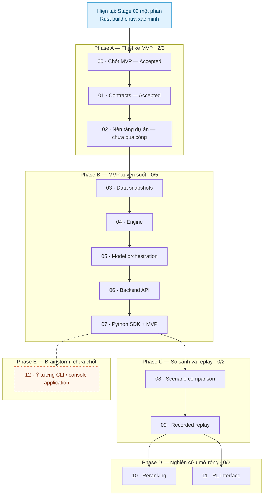

# Kế hoạch triển khai FactorsBT

**Status:** Proposed — phân rã công việc, chưa phải các tính năng đã triển khai.

**Mốc đối chiếu:** 2026-11-03. Stage 00–01 đã qua cổng thiết kế. Stage 02 có workspace Rust, kiểu contracts, health endpoint source và Python SDK; Rust build/backend runtime chưa xác minh được vì host thiếu MSVC linker/Windows SDK.

## Cách đọc và phạm vi

Bộ kế hoạch gồm 12 stage triển khai (00–11) và mục brainstorm 12. Mỗi stage ghi mục tiêu, đầu ra, phụ thuộc, quyết định Open, Task → Commit, kiểm chứng dự kiến và điều kiện hoàn thành. Chỉ thực hiện code sau khi quyết định cần thiết của stage được chốt.

Hướng Accepted là SDK thuần Python, backend/engine Rust, giao tiếp ban đầu HTTP/JSON. Các quyết định synthetic MVP ở Stage 00 và contracts ở Stage 01 đã được ghi nhận; phần nào chưa có code và kiểm chứng vẫn chưa phải tính năng Implemented.

- Wave 1: Phase A–B, từ thiết kế MVP tới một backtest chạy xuyên suốt.
- Wave 2: Phase C, thí nghiệm so sánh và recorded-response replay.
- Wave 3: Phase D, hai hướng nghiên cứu độc lập reranking và RL, vẫn là Proposed.
- Phase E: chỗ ghi nhớ ý tưởng ứng dụng, chưa đưa vào wave thực thi hay lịch triển khai.

Số stage 00–12 là đánh số chi tiết trong thư mục này, không thay thế số Stage 0–3 trong [roadmap gốc](../../docs/roadmap.md). Phase A–B phân rã roadmap Stage 1, Phase C tương ứng Stage 2, Phase D tương ứng Stage 3; Phase E là ý tưởng bổ sung chưa chốt. Tài liệu nền tảng của roadmap Stage 0 không được tính là engine hay MVP đã chạy được.

## Danh mục và bảng theo dõi

| Phase | Stage / mục | Trạng thái thiết kế | Đạt điều kiện hoàn thành | Bằng chứng |
| --- | --- | --- | --- | --- |
| A | [00 — Quyết định MVP](00-mvp-decisions.md) | Accepted | Có | [Scope](../../docs/product/mvp-scope.md), [fixture và acceptance cases](../../docs/examples/mvp/acceptance-cases.md) |
| A | [01 — Contracts](01-contracts.md) | Accepted | Có | [OpenAPI](../../contracts/openapi.json), [run schema](../../contracts/schemas/run-configuration.schema.json), [shared example](../../contracts/examples/instruments/minimal-valid-spot-run.json), [contract docs](../../docs/interfaces/service-contracts.md) |
| A | [02 — Nền tảng dự án](02-project-foundation.md) | Proposed | Chưa | [Lệnh và bằng chứng local](../../docs/development/phase-a-local.md), [preflight](../../docs/decisions/0002-phase-a-tooling.md#environment-preflight): thiếu MSVC linker và Windows SDK |
| B | [03 — Data snapshots](03-data-snapshots.md) | Proposed | Chưa | Chưa có |
| B | [04 — Simulation engine](04-simulation-engine.md) | Proposed | Chưa | Chưa có |
| B | [05 — Model orchestration](05-model-orchestration.md) | Proposed | Chưa | Chưa có |
| B | [06 — Backend API](06-backend-api.md) | Proposed | Chưa | Chưa có |
| B | [07 — Python SDK và nghiệm thu MVP](07-python-sdk-mvp.md) | Proposed | Chưa | Chưa có |
| C | [08 — Scenario comparison](08-scenario-comparison.md) | Proposed | Chưa | Chưa có |
| C | [09 — Recorded replay](09-recorded-replay.md) | Proposed | Chưa | Chưa có |
| D | [10 — Reranking](10-reranking.md) | Proposed | Chưa | Chưa có |
| D | [11 — RL interface](11-rl-interface.md) | Proposed | Chưa | Chưa có |
| E | [12 — Ý tưởng CLI / console application](12-cli-console-ideas.md) | Proposed — brainstorm | Không áp dụng | Chưa chốt triển khai |

Hiện có **2/12 stage đạt điều kiện hoàn thành**; MVP gồm stage 00–07 có **2/8**; Phase A là **2/3**. Stage 00 hoàn tất quyết định/fixtures; Stage 01 hoàn tất thiết kế OpenAPI/schemas/examples. Stage 02 có mã nền tảng và kiểm tra Python, nhưng build/type tests Rust và gọi endpoint thật chưa chạy được; vì vậy Stage 02 vẫn Proposed và Phase A chưa qua cổng. Chưa có backtest engine hoặc API chạy backtest được Implemented. Đây là số stage đạt cổng kiểm chứng, không phải tỷ lệ thời gian, khối lượng code hoặc ước lượng ngày giao hàng. Mục brainstorm 12 không nằm trong mẫu số.

Trạng thái thiết kế dùng đúng từ vựng của [documentation index](../../docs/README.md#status-vocabulary): Accepted, Proposed, Open và Implemented. Cột hoàn thành là theo dõi công việc riêng. Stage thiết kế có thể hoàn thành bằng quyết định được Accepted và tài liệu đã kiểm tra; điều đó không làm tính năng thành Implemented. Chỉ mô tả hành vi là Implemented khi có code và kiểm chứng phù hợp.

Khi tiến độ thay đổi, cập nhật hàng stage, số đếm, graph và dẫn chứng cùng nhau. Dẫn chứng cần chỉ đến quyết định, commit triển khai, kết quả kiểm tra và giới hạn liên quan. Viết xong file kế hoạch không phải bằng chứng hoàn thành stage.

## Graph tiến độ theo phase

Mũi tên liền biểu thị trình tự triển khai chính được đề xuất; phụ thuộc chi tiết nằm trong từng file stage. Hai nhánh Phase D độc lập nhau. Nét đứt tới Phase E chỉ gợi liên hệ ý tưởng, không phải phụ thuộc hay thời hạn đã chốt.

Phase E không yêu cầu Phase D hoàn thành. Mục 12 chưa chọn tính năng, ngôn ngữ, giao diện, dependency triển khai hoặc thời điểm làm; nếu được theo đuổi sẽ cần một kế hoạch riêng.

## Cổng hoàn thành theo phase

| Phase | Đầu vào / phụ thuộc | Kiểm chứng và điều kiện ra |
| --- | --- | --- |
| A | Docs nền tảng và ADR 0001 | Quyết định MVP đủ dùng được chốt; hai phía hiểu cùng hợp đồng; công cụ tối thiểu chạy được và lệnh được xác minh. |
| B | Phase A | Chạy từ SDK qua Rust backend, adapters và engine; evidence nối input tới portfolio; các ca temporal visibility, shared capital, execution và failure đúng quy tắc. |
| C | MVP Phase B | Scenario cách ly mutable state, khác biệt có thể giải thích; recorded replay được kiểm tra trong phạm vi công bố và khác fresh inference. |
| D | Comparison/replay Phase C và thiết kế nghiên cứu được chấp nhận | Mỗi nhánh có contract, ví dụ bounded và kiểm chứng với vốn, thời gian, isolation và replay; không cam kết model cải thiện. |
| E | Chưa xác lập đầu vào thực thi | Chỉ brainstorm; không có cổng nghiệm thu ứng dụng hoặc yêu cầu hoàn thành để đóng MVP. |

## Task, commit và kiểm chứng

### Lần tạo bộ tài liệu này — 2026-11-02

- Làm trực tiếp trên `main`; tạo stage 00–11, mục 12 rồi README, mỗi file một commit: 14 commit.
- Commit stage có dạng `docs(plan): add stage 00 MVP decisions`; mục 12 là `docs(plan): record CLI console application ideas`; README là `docs(plan): add implementation overview and phase graph`.
- Chỉ stage đường dẫn tường minh. Trước mỗi commit kiểm tra branch, working tree, index, staged diff và whitespace; sau commit kiểm tra file và summary.
- Kiểm tra links, Markdown, thuật ngữ, status, dependencies, graph và diff của cả bộ; sau đó push lên `origin/main` theo phạm vi đã duyệt. Không thêm CI, dependency hoặc code sản phẩm.
- Tại thời điểm tạo kế hoạch chưa có source implementation hay test code. Repository chưa có CI tại mốc đối chiếu; không báo CI passed khi không có run.

### Tiến độ thực hiện Phase A — 2026-11-03

- Các commit 17–27 trên `main` tạo tooling ADR, Rust workspace/contracts/backend health source, Python package/client, shared-example tests, smoke script và hướng dẫn local. Danh sách chi tiết nằm trong [Stage 02](02-project-foundation.md).
- Python unittest cùng JSON Schema Draft 2020-12 đã chạy thành công trong virtualenv test; `cargo fmt` và `cargo metadata` cũng thành công.
- `cargo check`, `cargo test` và smoke test đều đã thử. Rust build dừng trước compile code vì không có `link.exe`; service không khởi động nên smoke chưa xác minh được.
- Commit 28 ghi nhận trạng thái và bằng chứng chưa qua cổng, không đánh dấu Stage 02/Phase A hoàn tất. Chưa push vì điều kiện push của kế hoạch chưa đạt; repository chưa có CI.
- Các lần tiếp theo tiếp tục theo [commit-workflow](../../.agents/skills/commit-workflow/SKILL.md), xác minh diff/staged scope, test và trạng thái remote cho từng đợt.
- Chốt quyết định Open trước khi task phụ thuộc bắt đầu; cập nhật contracts hai phía và ảnh hưởng tới kết quả lưu trữ. Ghi ADR cho thay đổi kiến trúc đáng kể, không xóa lịch sử quyết định cũ.
- Giữ các ranh giới: event/availability/processing time; decision/order/fill; mutable scenario state/immutable input; recorded replay/fresh inference.

## Tài liệu gốc

- [Documentation index](../../docs/README.md)
- [Roadmap](../../docs/roadmap.md)
- [Architecture overview](../../docs/architecture/overview.md)
- [Simulation lifecycle](../../docs/architecture/simulation-lifecycle.md)
- [Service contracts](../../docs/interfaces/service-contracts.md)
- [ADR 0001](../../docs/decisions/0001-python-sdk-rust-backend.md)
